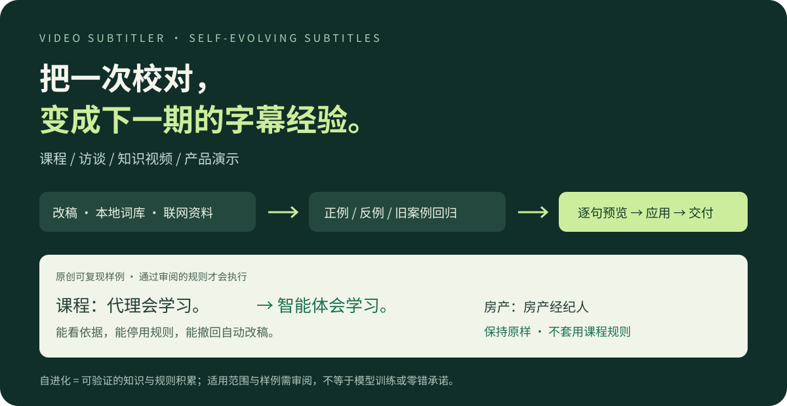

# Video Subtitler · 自进化字幕

**把一次校对，变成下一期的字幕经验。** 为持续制作课程、访谈、知识视频和产品演示的创作者，
把改稿、本地词库和联网资料沉淀为可复用的字幕规则。**先看改前对照，再应用；规则可以停用，自动改稿可以撤回。**



**0.5.0 开发版**：自进化执行闭环已实现；本版尚未发布到 SkillPay。

| 你遇到的事 | 这个 Skill 如何帮你 |
|---|---|
| 同一术语，每期都要重新改 | 从已审阅词库建立术语规则，适用范围内确定性替换已知旧译法 |
| 新知识查到了，担心引用不可靠 | 保留来源与逐字引文；联网证据过期或变化会阻止旧规则继续交付 |
| 不知道 Agent 到底改了什么 | HTML 改前预览列出每句变化、依据与待处理项；预览不改原稿 |
| 课程的 agent 与房产的 agent 混用 | 用频道、语言、领域和排除项隔离；正例改善、反例不误改才允许启用 |

例如，课程中的「代理会学习。」可变为「智能体会学习。」；房产语境的「房产经纪人」保持原样。
这是仓库原创样例的可复现行为，不代表对任意语境的正确率承诺。

## 自进化做了什么

| 输入 | 程序执行 | 输出前约束 |
|---|---|---|
| 已审阅的改稿 | 提取精确句子译法、原文纠错候选 | 不能未经测试直接生效 |
| 本地词库或带引文的文本资料 | 保存快照，生成有适用范围的术语规则 | 固定 schema；不执行资料中的代码或指令 |
| 公网 HTTPS 资料 | 保存引文、哈希、有效期；可刷新并检测变化 | 来源变更或过期时，旧规则阻止交付 |
| 已启用经验 | 确定性改写字幕，保留修改前快照 | 正例必须改善，反例不能误改，旧案例不得退化 |

规则启用后，编辑、翻译、校对、项目级检查/渲染/交付共用执行检查。
绑定了记忆库的项目省略 `--memory` 会报错；`--no-glossary` 和 `--draft`
都不能绕过已学习约束。支持来源刷新、规则停用与字幕修改撤销。

当前可执行经验为**术语映射、精确句子翻译、精确原文纠错**。
这是知识与规则的持续积累，不是重新训练 Whisper，也不保证所有新句子的语义正确。

## 先体验

需要 Python 3.9+，建议使用虚拟环境：

```bash
python -m venv .venv
# Windows：.venv\Scripts\activate
# macOS / Linux：source .venv/bin/activate
python -m pip install .
python -m subtitler doctor --core
python -m subtitler evolve demo --output evolution-demo
```

打开 `evolution-demo/index.html`：查看第一次改稿、下一段实际变化、
房产语境反例、被拦截的导出和撤销结果。数据来自程序实际执行。
原创文本样例不下载模型、不调用付费 API，不是识别准确率测试。
核心安装无第三方运行时依赖；可先体验再配置视频识别。上述命令从本项目/Skill 文件夹运行。

增加真实联网学习演示（从 Python 官方中文术语表获取证据）：

```bash
python -m subtitler evolve demo --online --output evolution-demo-online
```

联网失败会明确报错，不会伪装成成功。自己接入资料、审阅与启用规则的操作见
[自进化使用说明](references/evolution.md)。

## 处理自己的视频

```bash
python -m pip install ".[media]"
python -m subtitler doctor
python -m subtitler transcribe video.mp4 --to zh --device cpu
python -m subtitler batch video.subtitler.json --size 40
python -m subtitler apply video.subtitler.json edits.json
python -m subtitler evolve init --memory channel.sqlite3
python -m subtitler evolve bind video.subtitler.json --memory channel.sqlite3 --profile my-channel --domain education
python -m subtitler evolve preview video.subtitler.json --memory channel.sqlite3 --output change-preview-v1
python -m subtitler evolve apply video.subtitler.json --memory channel.sqlite3
python -m subtitler check video.subtitler.json --memory channel.sqlite3
python -m subtitler deliver video.subtitler.json --output delivery-v1 --memory channel.sqlite3
```

`batch` 给当前 Agent 提供待翻译字幕，Agent 生成 `edits.json`：

```json
{"1":"第一条译文","2":{"text":"修正后的原文","translation":"第二条译文"}}
```

不需要翻译时省略 `--to zh` 和翻译步骤。各命令提供 `--help`。
同一频道后续视频复用已有 `channel.sqlite3`，不要重复 `init`。
新库初始没有规则；按自进化说明学习并启用后才会自动改写字幕。
绑定后再使用 `batch` / `apply` / `translate` / `proofread` 时也要传 `--memory`。
支持分批翻译并保存进度；未完成的译文在预览中标出，正式交付仍执行检查。
若项目引用外部词库，读取该词库的命令还须加 `--kb-file /absolute/words.json`。

记忆库包含私人改稿与来源快照，不应进入商品 ZIP。联网证据抓取不发送视频或字幕，
只 GET 明确允许的公网 HTTPS 页面。规则通过测试只证明符合已审阅案例。

| 交付文件 | 用途 |
|---|---|
| subtitles.srt / .vtt / .ass | 播放器、网页与带样式字幕 |
| project.json | 原文、译文、时间轴，方便继续修改 |
| review.html / qa.json | 漏译、重叠、阅读速度等规则检查 |
| manifest.json | 文件 SHA-256，核对完整性 |

检查错误会阻止正式交付；`--draft` 可导出待修订稿。输出必须是新目录。
交付包不携带原视频或本机词库路径。

## 成本与边界

- 首次识别需下载 Whisper 模型；内存与时间取决于模型、硬件和视频。
- FFmpeg 为视频处理依赖；CUDA/GPU 可选，CPU 可运行但可能较慢。
- 可用当前 Agent 翻译；独立翻译 API 需自行提供账号并承担费用。
- 本地识别不主动上传视频；外部翻译 API 会接收字幕文本。
- 检查通过不等于语义正确；人名、数字、专词和音画同步仍需抽查。
- 不提供自动 OCR 核验、准确率保证、MCP 服务或托管算力。

更多命令见 [使用流程](references/workflows.md)；商品材料见
[SkillPay](docs/SKILLPAY.md)，测试边界见 [验收记录](docs/ACCEPTANCE.md)。
参赛材料与四项复核见 [比赛准备与待验证项](docs/LAUNCH_REVIEW.md)。

## 开发

```bash
python -m pip install ".[media]" pytest
python -m pytest -q
python tools/build_skill.py
```

商品包采用文件白名单，排除实录字幕、历史视频、日志与缓存。
CI 验证 Windows/Linux 的离线流程；模型识别和平台支付需单独验证。
源码按 [MIT](LICENSE) 开源；付费商品不能取消原有 MIT 权利，
不得宣称独占源码或未经验证的服务承诺。
